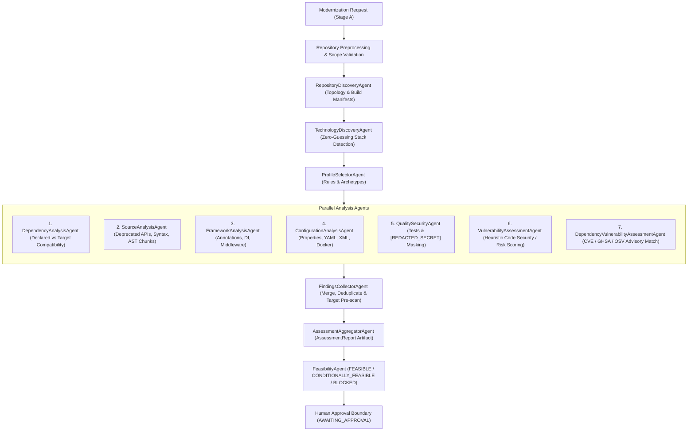
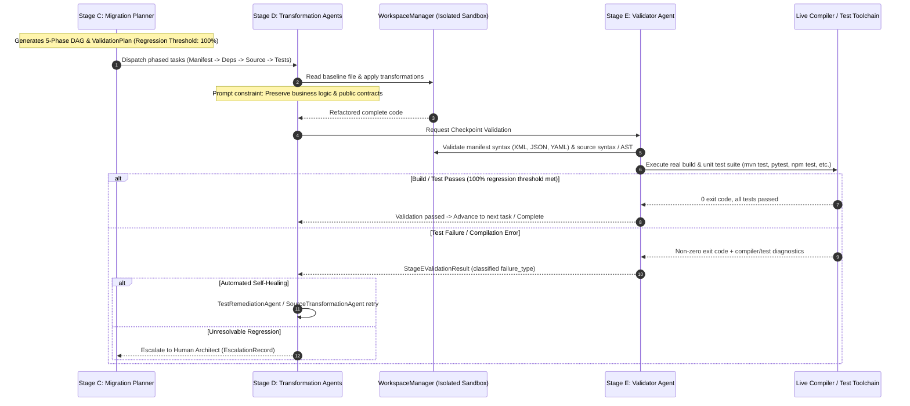

Ran list repository root directory contents
Ran search docs for equivalence and analysis
Ran search app and docs for equivalence
Ran list directory tree of app
Ran list agent files and docs
Analyzed stage_d_execution_validation_report.md:L1-67
Analyzed agents_overview.txt:L1-200
Analyzed source_transformation_prompt.py:L1-46
Analyzed agents_overview.txt:L190-246
Analyzed stage_e_validator.py:L1-150
Analyzed test_remediation_agent.py:L1-100
Analyzed design.md:L1-100
Analyzed architecture.md:L50-120
Ran search for 'functional' across docs and app
Ran list test files
Analyzed source_analysis.py:L1-100
Analyzed assessment_orchestrator.py:L1-100
Analyzed source_transformation_agent.py:L1-100
Analyzed stage_e_validator.py:L151-300
Analyzed stage_e_validator.py:L301-450
Analyzed migration_blueprint.py:L1-66
Analyzed migration_planner.py:L100-160
Analyzed migration_planner_prompt.py:L1-100

In the **Mira Modernize Platform**, **Analysis** and **Functional Equivalence** are handled systematically across the 5 lifecycle stages (**Stages A through E**), combining deterministic parsing, multi-agent parallel reasoning, isolated sandboxing, and real compiler/test toolchain verification.

Here is an architectural and operational breakdown of how both are handled:

---

## 1. How Analysis is Handled (Stage A & Stage B)

Analysis is conducted through a multi-dimensional, layered pipeline governed by Google Agent Development Kit (ADK) agents, progressing from zero-guessing deterministic discovery to parallel LLM-driven deep code and security inspection.

### Key Analysis Mechanisms:
1. **Deterministic Discovery & Stack Detection**:
   - `RepositoryDiscoveryAgent`: Scans the workspace topology and catalogs build files ([`pom.xml`](file:///d:/Mira_modernize_stageC/docs/architecture.md), `package.json`, `.csproj`, `requirements.txt`, etc.).
   - `TechnologyDiscoveryAgent`: Uses manifest and XML parsers (`xml.etree.ElementTree`, regex, TOML/JSON parsers) to identify exact language runtimes, framework versions, and build systems without guessing.
   - `scope_utils.py`: Enforces filesystem boundaries (`IN_SCOPE`, `OUT_OF_SCOPE`, `GLOBAL_META`) so analysis focuses only on approved targets.

2. **7-Dimension Parallel Findings Analysis (`ParallelAgent`)**:
   Runs concurrently across seven specialized agents in a thread pool (`max_workers=7`):
   - **Dependency Analysis** (`DependencyAnalysisAgent`): Compares current dependencies against target platform compatibility matrices; flags deprecated libraries and breaking changes.
   - **Source Analysis** (`SourceAnalysisAgent`): Samples code into token-bounded chunks and inspects AST constructs, deprecated method calls, removed classes, and target language paradigm shifts.
   - **Framework Analysis** (`FrameworkAnalysisAgent`): Evaluates framework-specific primitives (e.g., Spring Boot 2 to 3 migration, Java EE `javax.*` to Jakarta EE `jakarta.*`, ASP.NET to .NET Core).
   - **Configuration Analysis** (`ConfigurationAnalysisAgent`): Inspects properties, YAML, XML schemas, and environment/container configs.
   - **Quality & Secret Analysis** (`QualitySecurityAgent`): Audits test harness presence while strictly masking sensitive credentials using mandatory `[REDACTED_SECRET]` filters.
   - **Code Vulnerability Assessment** (`VulnerabilityAssessmentAgent`): Performs heuristic code security analysis against OWASP/CWE standards with qualitative risk scores (`CRITICAL`, `HIGH`, `MEDIUM`, `LOW`).
   - **Dependency CVE Assessment** (`DependencyVulnerabilityAssessmentAgent`): Matches declared third-party artifacts against CVE, GHSA, and OSV databases.

3. **Aggregation & Feasibility Classification**:
   - `AdkFindingsCollectorAgent` merges and deduplicates all findings into `assessment-findings.json`.
   - `AssessmentAggregatorAgent` produces the final `AssessmentReport`.
   - `FeasibilityAgent` classifies the migration viability (`FEASIBLE`, `CONDITIONALLY_FEASIBLE`, `BLOCKED`) and pauses execution at a strict **Human Approval Boundary** (`AWAITING_APPROVAL`).

---

## 2. How Functional Equivalence is Handled (Stages C, D, and E)

Functional equivalence ensures that modernizing runtime targets, frameworks, and syntax **preserves identical business behavior, public API contracts, and integration semantics without regressions**. 

Mira Modernize achieves this through a multi-tier governance model:

### 1. Stage C: Planning & Regression Contracts
- **Ordered DAG Blueprint**: `MigrationPlannerAgent` sequences work into 5 strict phases to avoid premature compilation failures:
  - *Phase 1*: Workspace & Baseline Isolation
  - *Phase 2*: Build & Target Runtime Manifests
  - *Phase 3*: Dependency Upgrades & Compatibility
  - *Phase 4*: Source-Level & Framework Transformations
  - *Phase 5*: Automated Verification & Checkpoint Validation
- **Explicit Validation Plan**: In [`migration_blueprint.py`](file:///d:/Mira_modernize_stageC/app/models/migration_blueprint.py#L50-L55), every blueprint defines a `ValidationPlan`:
  - `testSuites`: Declares the exact test suites to execute.
  - `regressionThreshold`: Set to **`"100% pass rate on existing unit tests"`** by default.
  - `checkpoints`: Explicit checkpoint gates (`build`, `unit_test`, `integration_test`) attached to phases.

### 2. Stage D: Transformation Constraints & Behavioral Parity
- **Prompt-Level Parity Contract**: System prompts for transformation agents (such as `SOURCE_TRANSFORMATION_INSTRUCTION` in [`source_transformation_prompt.py`](file:///d:/Mira_modernize_stageC/app/prompts/source_transformation_prompt.py#L10-L13)) explicitly enforce:
  > *"2. Ensure functional equivalence, preserving core business logic, comments, and public contracts."*  
  > *"Return complete and functional refactored source code without truncation, pseudocode, or placeholders."*
- **Sandbox Isolation (`WorkspaceManager`)**:
  - Transformations run inside `cloned_repos/{project_id}_workspace` rather than mutating production repositories directly.
  - Git branching and rollback snapshots allow immediate reversion if functional parity breaks.
- **Framework & Config Parity**:
  - `FrameworkTransformationAgent`: Converts framework scaffolding (dependency injection annotations, routing, filters) without altering method bodies or domain rules.
  - `ConfigMigrationAgent`: Translates property syntax and schema structures while preserving environmental and application property values.
- **Test Harness Remediation (`TestRemediationAgent`)**:
  - Adapts test frameworks (e.g., migrating JUnit 4 `@Test` to JUnit 5 `@Test`, updating assertions, mock configurations) **without watering down test assertions or altering expected behavior**, preserving the tests as valid behavioral oracles.
- **Human Escalation Boundary (`EscalationRecord`)**:
  - If a transformation encounters an ambiguous API change, missing prerequisite, or non-deterministic behavior, the orchestrator refuses to guess. It pauses and creates an `EscalationRecord` with structured resolution options for human review.

### 3. Stage E: Concrete Toolchain Validation (`StageEValidator`)
Functional equivalence is fundamentally verified using **actual compilers and test runners** on the transformed workspace:
1. **Manifest Syntax Check**: Verifies that XML (`pom.xml`, `.csproj`), JSON (`package.json`), TOML (`pyproject.toml`), and YAML files parse cleanly without syntax corruption.
2. **Source Syntax & AST Checks**: Runs Python AST compilation (`compile(content, f, "exec")`) and balanced brace inspection for C-family/brace languages (`.java`, `.cs`, `.ts`, `.go`, `.kt`, etc.).
3. **Live Toolchain Execution**: Invokes real installed CLI toolchains:
   - **Java / Maven**: `mvn test-compile` (build) and `mvn test` (test suite).
   - **Node.js**: `npm.cmd` / `npm run build` and `npm test`.
   - **.NET**: `dotnet build` and `dotnet test`.
   - **Python**: `pytest`.
   - **Go / Rust**: `go test`, `cargo check`.
4. **Structured Diagnostic Feedback Loop**:
   - Failures are classified into:
     - `configuration_syntax_error`
     - `source_syntax_error`
     - `build_failure`
     - `test_failure`
     - `infrastructure_error`
   - Test failures and compiler error snippets are returned to `StageDOrchestrator` to drive targeted automated self-healing remediation or trigger an escalation.

---

### Summary Matrix

| Capability | Component / Agent | Primary Mechanism |
|---|---|---|
| **Topology & Stack Discovery** | `RepositoryDiscoveryAgent`, `TechnologyDiscoveryAgent` | AST / Manifest inspection (`pom.xml`, `package.json`, `.csproj`, etc.) |
| **Multi-Vector Assessment** | 7-Agent `ParallelAgent` (`max_workers=7`) | Concurrently scans dependencies, source, framework, config, security, and CVEs |
| **Feasibility & Governance** | `FeasibilityAgent`, `WorkflowStateEngine` | Feasibility scoring and human approval boundary (`AWAITING_APPROVAL`) |
| **Planning & Verification Contract** | `MigrationPlannerAgent`, `ValidationPlan` | DAG ordering with mandatory **100% test pass rate** regression threshold |
| **Behavioral Preservation** | `SourceTransformationAgent`, `FrameworkTransformationAgent` | LLM prompts requiring strict preservation of business logic and public contracts |
| **Isolated Execution** | `WorkspaceManager` | Sandbox cloning (`cloned_repos/*_workspace`) with rollback checkpoints |
| **Equivalence Verification** | `StageEValidator`, `TestRemediationAgent` | Live build/test execution (`mvn test`, `pytest`, `npm test`, `dotnet test`) with structured failure categorization |
