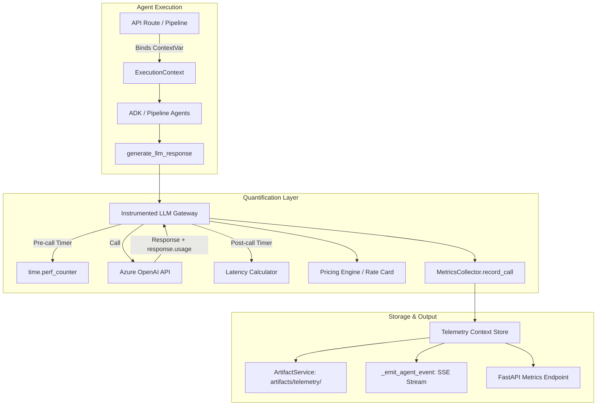

# Architectural Plan: Token, Cost, and Latency Quantification Layer

## Executive Overview

This specification details the engineering implementation for a non-intrusive, production-grade **Token, Cost, and Latency Quantification Layer** for the Mira Modernize platform.

### Design Principles
1. **Zero-Breaking-Change Guarantee:** Existing signatures like `generate_llm_response()` must continue returning `Optional[str]` seamlessly to ensure backwards compatibility across all Stages (B, C, D) and reporting services.
2. **Contextual Attribution:** Leverage Python `contextvars` to propagate `project_id`, `session_id`, `user_id`, `stage`, and `agent_name` down the call stack without polluting intermediate agent method signatures.
3. **Double-Capture Strategy:** Capture metrics at both the **granular LLM call level** (tokens, duration, finish reason, retry status, cost) and the **coarse agent/pipeline level** (total wall-clock time, accumulated tokens, phase total cost).
4. **OTel & SSE Ready:** Deliver metrics to artifacts storage, real-time Server-Sent Events (SSE) streaming, and prepare clean hook interfaces for OpenTelemetry exporters.

---

## Architecture Flow



---

## Core Components Specification

### 1. Quantification Data Models (`app/models/telemetry.py`)

```python
class TokenUsage(BaseModel):
    prompt_tokens: int = 0
    completion_tokens: int = 0
    total_tokens: int = 0
    cached_tokens: Optional[int] = 0

class LatencyMetrics(BaseModel):
    duration_ms: int
    started_at: str
    completed_at: str

class CostEstimate(BaseModel):
    input_cost_usd: float = 0.0
    output_cost_usd: float = 0.0
    total_cost_usd: float = 0.0
    rate_card_model: str

class LLMCallRecord(BaseModel):
    call_id: str
    project_id: str
    session_id: Optional[str] = None
    user_id: Optional[str] = None
    stage: str
    agent_name: str
    model: str
    deployment: str
    tokens: TokenUsage
    latency: LatencyMetrics
    cost: CostEstimate
    status: str  # "SUCCESS", "RETRY", "FAILED"
    finish_reason: Optional[str] = None
    error_message: Optional[str] = None

class ProjectMetricsSummary(BaseModel):
    project_id: str
    total_calls: int = 0
    total_prompt_tokens: int = 0
    total_completion_tokens: int = 0
    total_tokens: int = 0
    total_cost_usd: float = 0.0
    total_duration_ms: int = 0
    by_stage: Dict[str, Any] = Field(default_factory=dict)
    by_agent: Dict[str, Any] = Field(default_factory=dict)
    calls: List[LLMCallRecord] = Field(default_factory=list)
```

---

### 2. Pricing Catalog Engine (`app/services/pricing_service.py`)

A configurable pricing catalog calculating USD costs based on Azure OpenAI deployment mappings.

- **Default Rates (per 1,000,000 tokens):**
  - `gpt-4o` (2024-08-06+): Input $2.50 / Output $10.00
  - `gpt-4o-mini`: Input $0.15 / Output $0.60
  - `gpt-4-turbo`: Input $10.00 / Output $30.00
  - `o1` / `o3-mini` (Reasoning): Input $5.00 / Output $15.00
  - `gpt-6-luna` (internal alias): Maps to standard `gpt-4o` pricing table by default
- Allows override via environment variable `MIRA_PRICING_OVERRIDES_JSON` or custom config.

---

### 3. Context & Attribution Manager (`app/services/telemetry_context.py`)

Uses Python `contextvars` for thread-safe and async-safe context propagation across the pipeline:
- `current_project_id: ContextVar[str]`
- `current_session_id: ContextVar[Optional[str]]`
- `current_user_id: ContextVar[Optional[str]]`
- `current_stage: ContextVar[str]`
- `current_agent: ContextVar[str]`
- `current_collector: ContextVar[Optional[MetricsCollector]]`

Context manager utility:
```python
with telemetry_scope(project_id="my-proj", stage="STAGE_B", agent_name="source_analysis_agent"):
    # All LLM calls made in this scope automatically inherit attribution
```

---

### 4. Instrumented LLM Gateway (`app/agents/assessment/llm_utils.py`)

Refactor `generate_llm_response()`:
1. Capture start timestamp via `time.perf_counter()`.
2. Intercept `response.usage` object from `azure_client.chat.completions.create(...)`.
3. Support retry inspection (if initial call fails or produces empty output, accumulate tokens from retry).
4. Calculate cost using `PricingService`.
5. Dispatch record to active `MetricsCollector`.
6. Maintain exact return type `Optional[str]` for compatibility, and expose `generate_llm_response_with_metrics()` for callers requiring full metadata.

---

### 5. Pipeline & Event Integration (`app/agent.py`)

1. **`SequentialAgent` / `ParallelAgent` Instrumentation:**
   - Automatically wraps each child agent execution in `telemetry_scope(agent_name=agent.name)`.
   - Aggregates child agent token & cost metrics.
2. **`_emit_agent_event` Enhancement:**
   - Add `tokens`, `costUsd`, and `llmDurationMs` to `agent_completed` events streamed to the UI via SSE.

---

### 6. Persistence & Telemetry API (`app/services/telemetry_service.py` & `app/api/`)

1. Persist metrics automatically to:
   `artifacts/telemetry/<project_id>/metrics.json`
2. Add FastAPI route:
   `GET /projects/{project_id}/metrics` -> Returns `ProjectMetricsSummary`
   `GET /projects/{project_id}/metrics/summary` -> Quick aggregate cards (total tokens, total cost, total duration).

---

## Phased Implementation Roadmap

### Phase 1: Models & Core Pricing Engine
- Create `app/models/telemetry.py` with Pydantic schemas.
- Implement `app/services/pricing_service.py`.
- Unit tests for token costing and rate card overrides.

### Phase 2: Context Management & LLM Gateway Instrumentation
- Create `app/services/telemetry_context.py`.
- Refactor `app/agents/assessment/llm_utils.py` to record tokens, latency, and cost per call without changing external signatures.
- Update `.env.example` with complete Azure OpenAI variables.

### Phase 3: Agent Tree & Pipeline Integration
- Update `AdkBaseAgent`, `SequentialAgent`, and `ParallelAgent` in `app/agent.py`.
- Update `_emit_agent_event` to broadcast token/cost stats in real-time.
- Ensure thread safety inside `ParallelAgent` when multiple sub-agents execute concurrently.

### Phase 4: Persistence & REST API Endpoints
- Implement `TelemetryService` for artifact disk storage (`artifacts/telemetry/`).
- Add `/projects/{project_id}/metrics` endpoints to `app/api/routes_projects.py` or new `routes_telemetry.py`.
- Register the new router in `app/api/main.py`.

### Phase 5: Verification & End-to-End Testing
- Write automated tests in `tests/test_telemetry.py` validating:
  - Token and cost computation accuracy.
  - Context attribution propagation across nested sequential and parallel agents.
  - Graceful handling when LLM calls fail or Azure credentials are not set.
  - API endpoint response formats.
