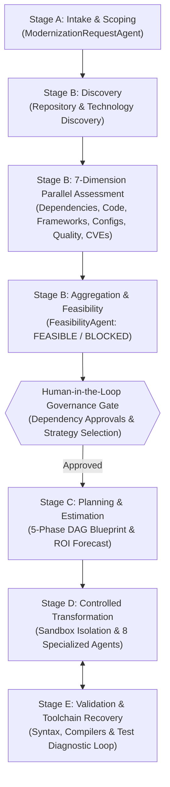

Ran git log check
Ran list directory contents
Analyzed README.md:L1-158
Analyzed agents_overview.txt:L1-200
Analyzed architecture.md:L1-200
Ran inspect app and docs directories
Ran git branch and status check
Analyzed architecture.md:L200-274
Analyzed test_model.py:L1-94
Ran check local diffs

To understand how we arrived at this current phase, we should look at this progression across two complementary dimensions:

1. **The Modernization Pipeline (Application Workflow)**: How a legacy enterprise application is ingested, analyzed, approved, and moved into **Stage C (Migration Planning & Estimation)** and downstream execution.
2. **The Engineering & Architecture Evolution (Codebase Development)**: How the platform evolved feature-by-feature across git milestones from an early proof-of-concept into the standardized, multi-agent platform you are currently running on `feature/1014_assesment_agents_refactor_1`.

---

# Part 1: The Modernization Pipeline (Stage-by-Stage Flow)



---

### **Stage A: Intake, Normalization & Scoping**
* **Goal**: Ingest raw user requests and normalize ambiguous inputs before touching any code.
* **Agent**: `ModernizationRequestAgent` (wrapped with Google ADK).
* **What Happens**:
  1. Accepts either unstructured text prompts (e.g., *"Upgrade this Java 8 Spring Boot app to Java 21 and Spring Boot 3"*) or structured JSON.
  2. Extracts languages, runtime versions, and framework targets using deterministic regex and pattern matching.
  3. Validates directory scope paths via `validate_scope_paths()` to ensure the project doesn't operate outside designated boundaries.
  4. Produces the canonical `modernization-request.json` artifact and transitions the state engine to `REQUEST_CREATED`.

---

### **Stage B: Discovery & 7-Dimension Parallel Assessment**
* **Goal**: Perform an exhaustive, zero-guessing audit of the legacy codebase.
* **Architecture**: Coordinated via an ADK `SequentialAgent` followed by a concurrent `ParallelAgent` (`parallel_findings_agent`):
  1. **Deterministic Discovery**:
     * `RepositoryDiscoveryAgent`: Scans file topology, identifies build tools (Maven, Gradle, npm, Python, Cargo, Go), and generates `repository-manifest.json`.
     * `TechnologyDiscoveryAgent`: Determines exact frameworks and runtimes from build manifests without LLM hallucinations.
  2. **7-Dimension Concurrent Analysis**:
     * **Dependency Analysis**: Evaluates third-party packages against target runtime compatibility.
     * **Source Analysis**: Scans syntax, token chunks, and deprecated APIs.
     * **Framework Analysis**: Maps annotations, dependency injection beans, and middleware.
     * **Configuration Analysis**: Parses YAML, XML, properties, and Dockerfiles.
     * **Quality & Secrets Review**: Runs quality checks and enforces mandatory `[REDACTED_SECRET]` token masking.
     * **Vulnerability Assessment**: Performs heuristic code security analysis and risk scoring.
     * **Dependency Advisory Matching**: Correlates dependencies with external vulnerability databases (CVE, GHSA, OSV).
  3. **Synthesis & Feasibility**:
     * `FindingsCollectorAgent` & `AssessmentAggregatorAgent`: Deduplicate and consolidate all findings into `assessment-report.json`.
     * `FeasibilityAgent`: Evaluates migration viability (`FEASIBLE`, `CONDITIONALLY_FEASIBLE`, or `BLOCKED`) and drafts migration alternatives.

---

### **The Governance Boundary: Human-in-the-Loop Approval Gate**
* **Goal**: Ensure no code modification begins without enterprise architectural sign-off.
* **State**: `AWAITING_HUMAN_DECISION`.
* **What Happens**:
  * The system halts. It presents required dependency upgrade decisions and architecture strategy alternatives to the human architect.
  * Every breaking dependency must be explicitly approved or rejected.
  * Once the architect submits their choices, `migration-decision.json` is persisted, transitioning the project to `DECISION_APPROVED`.

---

### **Stage C: Migration Planning & Estimation (Current Target Milestone)**
* **Goal**: Formulate a dependency-ordered, verifiable execution roadmap and forecast financial/developer ROI.
* **Agents/Services**: `MigrationPlannerAgent` and `EstimationService`.
* **What Happens**:
  1. **5-Phase Migration Blueprint Generation**:
     * **Phase 1: Environment & Workspace Baseline** (Branching, snapshot locks).
     * **Phase 2: Build Manifest & Dependency Modernization** (Upgrades, compiler levels).
     * **Phase 3: Framework & Configuration Migration** (Annotations, properties).
     * **Phase 4: Source Code & API Refactoring** (Imports, deprecated methods).
     * **Phase 5: Test Suite Modernization & Verification** (JUnit/Jest runners, assertions).
  2. **DAG Validation (Kahn's Algorithm)**: Detects circular dependencies and orders tasks topologically.
  3. **Scope Partitioning**: Assigns tasks strictly to `GLOBAL_META`, `IN_SCOPE`, or `OUT_OF_SCOPE`.
  4. **Pre-flight Estimation**: Computes estimated token consumption, cloud LLM costs (USD), developer person-hours saved, and projected ROI.
  5. Produces `migration-blueprint.json` and `modernization-estimate.json`, moving the workflow state to `MIGRATION_PLAN_READY`.

---

### **Looking Ahead: Stage D & Stage E (Execution & Toolchain Validation)**
* **Stage D (Controlled Transformation)**:
  * Creates an isolated sandbox clone in `cloned_repos/{project_id}_workspace` to protect pristine source code.
  * `StageDOrchestrator` uses LLM dynamic reasoning to dispatch tasks to 8 specialized agents (`BuildConfigurationAgent`, `DependencyMigrationAgent`, `SourceTransformationAgent`, etc.).
* **Stage E (Validation & Recovery)**:
  * `StageEValidator` runs real toolchain compilers (`mvn`, `gradle`, `npm`, `pytest`, `dotnet`).
  * If a build fails, compiler diagnostics feed back into Stage D for self-healing remediation loops.
* **Git Publishing**:
  * Pushes the modernized, verified workspace to remote providers (GitHub, GitLab, or Bitbucket) with an automated pull/merge request.

---

# Part 2: Engineering & Codebase Evolution (Phasewise Git History)

Looking at the repository commits and feature branches, here is how the engineering team built and refactored the platform:

```
[Phase 1: Foundation (1001-1002)] 
   └── Core ADK Agent Setup, Stage A/B Discovery & Initial Stage C Planner Data Models
         │
[Phase 2: Security & Governance (1003-1007, 1010)]
   └── PAT Encryption, Human Approval Gate, Scope Partitioning, CVE Scanners
         │
[Phase 3: Transformation Engine (1011-1013, code_migration_agent)]
   └── Workspace Sandbox (cloned_repos), Dynamic Orchestrator & Coupling Detection
         │
[Phase 4: Standardization & Refactoring (1014 Series - Current Branch)]
   └── Refactoring Assessment & Request Agents to Google ADK Standards, LLM Multi-provider
         │
[Phase 5: Validation & Publishing (1015-1016)]
   └── Stage E Toolchain Diagnostics & Multi-Provider Git Publishing (GitHub, GitLab, Bitbucket)
```

### **1. Phase 1 — Foundation & Initial Pipeline (`feature/1001`, `1002`)**
* Established the foundational FastAPI backend and React frontend.
* Built early versions of Stage B assessment agents (`1001_assessment_agent`) and initial planning structures (`1002_migration_planner`).

### **2. Phase 2 — Security, Governance & Scoping (`feature/1003` to `1010`)**
* **PAT Encryption (`1003`)**: Encrypted personal access tokens for secure repository cloning.
* **Human-in-the-Loop (`1006`)**: Added strict approval enforcement so no execution can bypass human decision-making.
* **Scope Isolation (`1007`)**: Added path traversal guards and bounded migration scoping to prevent agents from touching files outside the intended submodules.
* **Vulnerability & Advisory Scans (`1010`)**: Integrated CVE/GHSA scanning into the assessment pipeline.

### **3. Phase 3 — Transformation Sandbox & Migration Agents (`feature/1011`, `1012`, `1013`)**
* Implemented `WorkspaceManager` to clone repositories to `cloned_repos/{id}_workspace`, enforcing a strict command whitelist (`mvn`, `npm`, `dotnet`, `git`).
* Built the LLM-driven `StageDOrchestrator` with step-by-step checkpointing and rollback strategies.
* Added stack coupling detection (`1013`) to identify tightly coupled architectural bottlenecks before executing code edits.

### **4. Phase 4 — Google ADK Refactoring & Standardization (`1014` series — Active Branch)**
* **Current Branch**: `feature/1014_assesment_agents_refactor_1`.
* Standardized all agent prompts, instructions, and output models using the Google Agent Development Kit (ADK) pattern.
* Refactored `ModernizationRequestAgent`, `AssessmentOrchestrator`, and `MigrationPlannerAgent` into formal ADK `LlmAgent`, `SequentialAgent`, and `ParallelAgent` structures.
* Tuned concurrency (`max_workers`) and added multi-provider LLM support (Azure OpenAI, Gemini, and local Ollama support via [test_model.py](file:///d:/BALAJI/Mira_modernize_stageC/test_model.py)).

### **5. Phase 5 — Validation Refactor & Git Publishing (`feature/1015`, `1016`)**
* **Stage E Refactor (`1015`)**: Modularized syntax checkers (XML, JSON, YAML) and native build toolchain invocations.
* **Git Publishing (`1016`)**: Integrated multi-provider git publishing, allowing verified modernized code to be committed and opened as PRs/MRs directly to GitLab, GitHub, or Bitbucket.

---

### **Summary of Current State**
You are currently in **`Mira_modernize_stageC`** on the **`feature/1014_assesment_agents_refactor_1`** branch. The platform has mature, tested Stage A through Stage E capabilities:
* Stage A (Intake) and Stage B (Assessment) are fully refactored and standardized with ADK prompts and schemas.
* Stage C (Planning) accurately generates Kahn's DAG-verified blueprints and ROI estimation.
* The workspace is currently configured to support seamless switching across LLM providers (Azure OpenAI, Gemini, and Ollama) with recent concurrency optimizations in [app/agent.py](file:///d:/BALAJI/Mira_modernize_stageC/app/agent.py).
